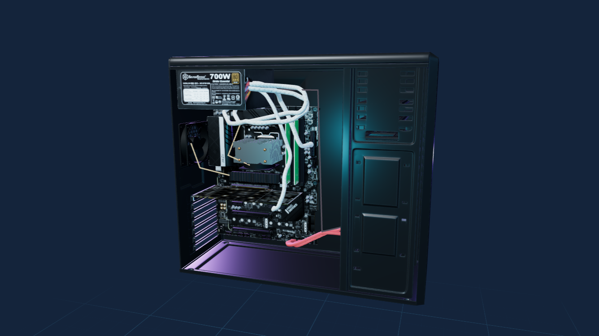

# Simulador 3D de Ensamblaje de PC — UNDC

Aplicación educativa ejecutada completamente en el navegador para explorar hardware y practicar el ensamblaje guiado de una PC, una laptop y una estación completa. No usa backend ni recopila datos personales.

## Demo

[Abrir el simulador publicado](https://ensamble-pc-undc.netlify.app/)



## Funciones implementadas

- Navegación entre inicio, biblioteca de modelos y simuladores.
- Ensamblaje guiado y modo práctica con validaciones de orden y retroalimentación.
- Escenas 3D con cámara orbital, enfoque, zoom y controles adaptados a pantallas pequeñas.
- Montaje de PC, laptop y estación periférica.
- Colocación de piezas y tornillos, conexiones internas y externas, animaciones y progreso persistente local.
- Indicadores globales de carga y recuperación visual cuando falla un recurso 3D.

## Tecnologías

React 19, TypeScript 5, Vite 8, Three.js, React Three Fiber y Drei.

## Requisitos

- Node.js 24 para desarrollo y compilación.
- Navegador moderno con WebGL 2 y aceleración gráfica habilitada.
- Se recomienda conexión de banda ancha: algunas escenas cargan modelos GLB de entre 10 y 31 MiB.

## Desarrollo local

```powershell
npm.cmd ci
npm.cmd run dev
```

Abre `http://127.0.0.1:5173/`.

## Comandos

```powershell
npm.cmd run format:check
npm.cmd run lint
npm.cmd run typecheck
npm.cmd test
npm.cmd run build
npm.cmd run check
npm.cmd run preview
```

## Estructura

```text
public/               Recursos estáticos, modelos GLB, imágenes y atribuciones
src/components/ui/    Controles compartidos
src/data/             Catálogos, rutas y configuración de escenas
src/domain/           Reglas puras y pruebas automatizadas
src/features/         Vistas y espacios de trabajo
src/scene/            Escenas, cámaras, modelos e interacciones 3D
src/state/            Persistencia local validada
src/styles/           Diseño adaptable
docs/                 Créditos, licencias y guía de recursos 3D
```

Los datos describen piezas y ubicaciones; el dominio valida las acciones; React presenta los paneles; y React Three Fiber representa el mismo estado en las escenas 3D. El simulador es didáctico y no certifica compatibilidad eléctrica, térmica o dimensional de hardware real.

## Despliegue

Netlify ejecuta `npm run build`, publica `dist/` y aplica la configuración de `netlify.toml`. Los cambios enviados a `main` generan un nuevo despliegue cuando el repositorio está conectado al sitio.

## Recursos y licencias

El código del proyecto no declara una licencia de reutilización general. Los modelos y recursos de terceros conservan sus propias licencias; varios requieren atribución y algunos limitan el uso a fines no comerciales y exigen compartir adaptaciones bajo la misma licencia. Consulta [docs/asset-credits.md](docs/asset-credits.md), [docs/modelos.md](docs/modelos.md) y [public/models/creagal/LICENSE.txt](public/models/creagal/LICENSE.txt) antes de redistribuir o reutilizar contenido.

Los logotipos institucionales son material proporcionado para este proyecto y no se publican bajo las licencias Creative Commons de los modelos 3D.

## Actualizaciones

Trabaja en una copia o rama, ejecuta `npm.cmd run check`, crea un commit y envíalo a `main`. Netlify volverá a compilar automáticamente. No agregues `node_modules`, `dist`, respaldos, archivos fuente de Blender ni descargas originales.
